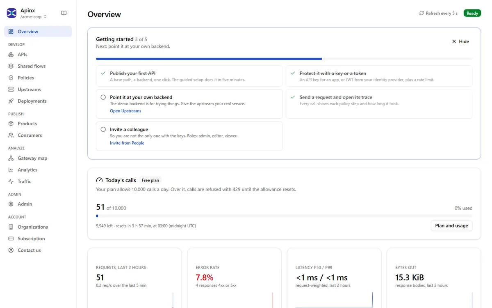
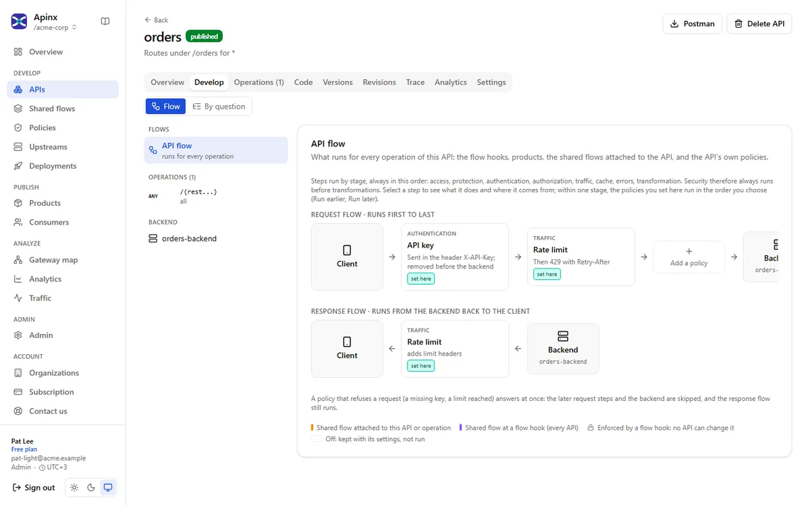
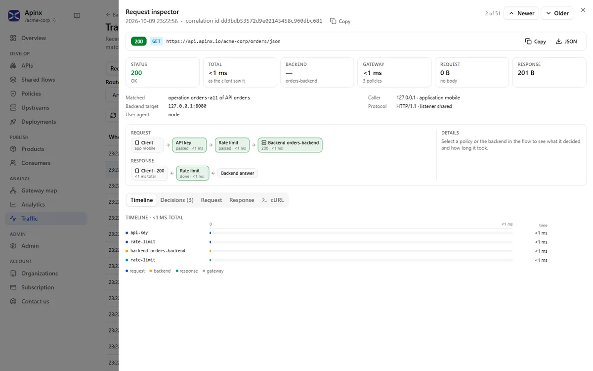
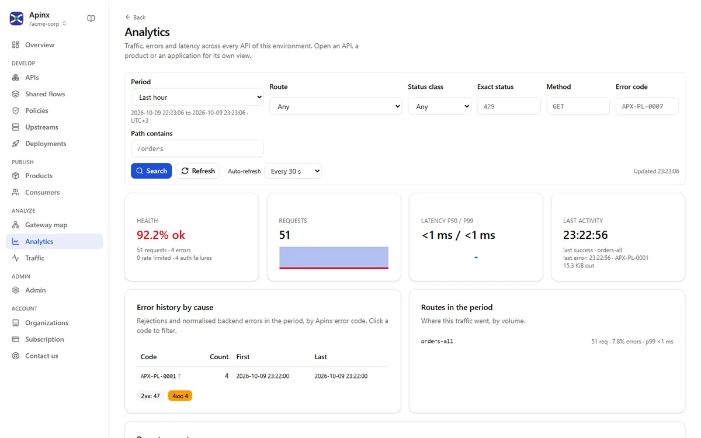
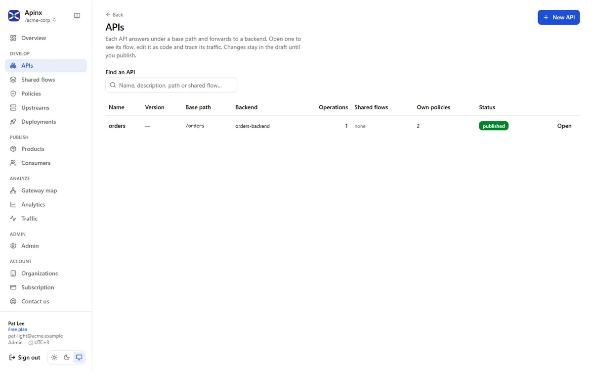

  <picture>
    <source media="(prefers-color-scheme: dark)" srcset="assets/brand/apinx-lockup-dark.svg">
    
  </picture>

  <b>Lightweight, fast, simple API gateway all in one file.</b> 
  A gateway, an Admin API and a friendly console in a single product. Publish a protected, rate-limited API in five minutes.

  
  

  <a href="https://apinx.io">Website</a> ·
  <a href="https://apinx.io/docs/">Documentation</a> ·
  <a href="https://github.com/moznhub/apinx/discussions">Community</a> ·
  <a href="mailto:sales@moznhub.com">Talk to sales</a>

---

This repository is the public home of **Apinx**: examples, the changelog, and the place to ask
questions and report issues. The source code is not published here. Apinx is a commercial
product by [MoznHub](https://moznhub.com).

<picture>
  <source media="(prefers-color-scheme: dark)" srcset="assets/screenshots/overview-dark.webp">
  
</picture>

## Why we built a new API gateway

Every team that puts APIs in front of partners, mobile apps or other teams needs the same
things: keys and tokens checked, traffic limited, answers shaped, and a clear record of what
happened to each call. The gateways that do this well were not built for most of the teams
that need them.

- **Too many moving parts.** A typical enterprise gateway is a proxy, a management server, its
  own database, a portal and a set of plugins, often on a JVM or a cluster. Getting the first
  request through is a project before it is a product.
- **The important features cost extra.** In open-source gateways, products and plans, OAuth to
  the backend, and a real console are often in the paid enterprise edition. The free part is a
  proxy you configure with files.
- **Hosted only, or heavy to own.** The richest API platforms run in someone else's cloud.
  Regulated organisations, whose data must stay in their own country or their own data centre,
  are left with the heaviest products to install and operate.
- **Hard to see inside.** When a call fails, the question is always the same: which rule
  refused it, and what did the backend really receive? Most gateways answer with log lines.

We built Apinx to remove those trade-offs: the API management model that enterprises already
know from the large API platforms, in one product that a single team can install, understand
and run, in the cloud or entirely on its own servers.

## What makes Apinx different

- **One product, console first.** No separate management server, portal or database to run.
  SQLite is built in. Use PostgreSQL when you have it.
- **The enterprise model without the platform.** Policies at Global, Environment, Product, API and
  Operation level. Shared flows, locked flow hooks, revisions with rollback, versions with
  deprecation, and products with plans and quotas.
- **You can see what happened.** Every request has a timeline of every policy decision and the
  backend call, with credentials redacted. Send a test request and see its trace next to the
  answer.
- **Fast and measured.** 46,000 requests per second at a p50 of 0.8 ms on a laptop, with the
  access log on. Rate limits are exact under load. The request path never touches the database.
- **Yours to run.** On premises, Apinx runs on your own servers, including air-gapped networks.
  The licence is perpetual, covers unlimited instances, is verified offline, and nothing calls
  home. If a licence ever lapses, your deployed APIs keep serving traffic.

### Compared with the usual choices

| | Apinx | Open-source gateways | Hosted API platforms | Self-hosted API managers |
|---|---|---|---|---|
| One product with the console inside | Yes | No | No (hosted) | No |
| Runs entirely on your servers, offline | Yes | Yes | No | Yes |
| Revisions, deploy and rollback per API | Yes | Often external tooling | Yes | Yes |
| Visual policy flow with a trace of every step | Yes | Rarely | Yes | Partial |
| Products, plans and subscriptions | Yes | Often paid editions only | Yes | Yes |
| API versions with a deprecation lifecycle | Yes | Rarely | Partial | Yes |
| Locked rules every API must run | Yes | Partial | Yes | Yes |
| OAuth 2 sign-in to the backend | Yes | Often paid editions only | Yes | Yes |
| Clustering and high availability | Yes | Yes | Yes | Yes |
| Own identity server, developer portal | Roadmap | Often paid editions only | Yes | Yes |

Apinx stands on years of good ideas from the API management field.

## Your first API in five minutes

1. **Backend:** name the API and point it at your service.
2. **Protection:** keep **API key**. An application and its first key are created for you.
3. **Rate limit:** keep 60 a minute, or set your own.
4. **Publish:** nothing restarts. The draft becomes an immutable revision and goes live with no
   dropped requests. Rollback is one click.
5. **Try it:** **Send test request** calls through the real gateway and shows the answer next
   to its trace.

Every request then shows up in **Analyze › Traffic** with its policy timeline, and in
**Analytics** a minute later. The full walkthrough is in
[Your first API](https://apinx.io/docs/getting-started/first-api/).

## What's inside

| Area | |
|---|---|
| Protocols | HTTP/1.1, HTTP/2 (h2c and TLS), gRPC pass-through (unary and streaming), WebSocket, Server-Sent Events |
| Routing | Hosts, path patterns with parameters, methods, header conditions, priorities, prefix stripping |
| Upstreams | Round robin, weighted, least connections, consistent hash; active and passive health checks; retries; circuit breaker; timeouts |
| Authentication | API keys, JWT (JWKS, discovery or inline keys), HTTP Basic; OAuth 2 to the backend |
| Traffic | Rate limits (three algorithms, four keys), concurrency limits, quotas per day or month |
| Protection | Threat protection (JSON, XML, injection patterns), size limits, IP filters, CORS, method allow lists |
| Transformation | Headers, path and query; jq body programs with a preview; status rules; normalized errors |
| Composition | Service callouts in parallel, stitched into one answer; forward, mock responses, mirroring |
| Lifecycle | Drafts, immutable revisions, deploy and rollback, environments, versions with deprecation and sunset |
| Products | Products, plans, subscriptions with approval, usage per subscription |
| Console | Every capability as a screen, a visual policy flow, a code tab, OpenAPI and Postman import, an AI assistant |
| Observability | Request inspector, analytics, gateway map, access log, Prometheus metrics, audit with export |
| Operations | SQLite or PostgreSQL, clustering over PostgreSQL with Redis counters, backup and restore, `apinxctl` for CI |

<table>
  <tr>
    <td width="50%">
      <picture>
        <source media="(prefers-color-scheme: dark)" srcset="assets/screenshots/flow-dark.webp">
        
      </picture>
      
The policy flow of an API

    </td>
    <td width="50%">
      <picture>
        <source media="(prefers-color-scheme: dark)" srcset="assets/screenshots/inspector-dark.webp">
        
      </picture>
      
Every request, step by step

    </td>
  </tr>
  <tr>
    <td width="50%">
      <picture>
        <source media="(prefers-color-scheme: dark)" srcset="assets/screenshots/analytics-dark.webp">
        
      </picture>
      
Analytics

    </td>
    <td width="50%">
      <picture>
        <source media="(prefers-color-scheme: dark)" srcset="assets/screenshots/apis-dark.webp">
        
      </picture>
      
Your APIs

    </td>
  </tr>
</table>

## Editions

| | Apinx Cloud | Apinx on premises |
|---|---|---|
| Where it runs | Hosted by MoznHub | Your own servers, including air-gapped networks |
| Licence | Plans, including a Free plan | Perpetual, unlimited instances, verified offline |
| Get started | [apinx.io](https://apinx.io) | [sales@moznhub.com](mailto:sales@moznhub.com) |

## In this repository

| Path | What |
|---|---|
| [`examples/`](examples/) | API definitions and Postman collections you can import into Apinx |
| [`CHANGELOG.md`](CHANGELOG.md) | What changed in each version |
| [Discussions](https://github.com/moznhub/apinx/discussions) | Questions, ideas, and how others use Apinx |
| [Issues](https://github.com/moznhub/apinx/issues/new/choose) | Bug reports and feature requests |

## Help and feedback

- **Documentation:** [apinx.io/docs](https://apinx.io/docs/).
- **Questions and ideas:** [GitHub Discussions](https://github.com/moznhub/apinx/discussions).
- **Bugs:** [open an issue](https://github.com/moznhub/apinx/issues/new/choose).
- **Customers:** [support@moznhub.com](mailto:support@moznhub.com), with your licence number.
- **Security issues:** never in a public issue. See [SECURITY.md](SECURITY.md).

## Licence

Apinx is proprietary software, © MoznHub. No software is distributed from this repository. The
examples here are under the MIT licence, so you can copy and adapt them freely. See
[LICENSE](LICENSE).
